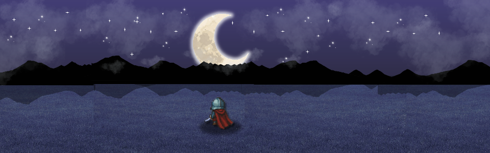

<p align="center">
  
</p>

# Solaris: Knight of the Crescent Moon

[](https://www.python.org/)
[](https://github.com/pygame-community/pygame-ce)
[](#)
[](#)
[](#)
[](https://katsumi001.itch.io/solaris)

> _One knight. One promise. One crescent moon._

A 2D top-down fantasy RPG built with **Python** and **Pygame CE**. Explore ten pixel-art zones, fight in **turn-based combat** driven by an **elemental wheel** and **seven stackable status effects**, and rescue **Princess Lunaire** from **Gorgona, the Vain Empress**.

---

## Story

You are **Solaris**, a young knight bound by a childhood promise to **Princess Lunaire**. When the ancient serpent sorceress **Gorgona** kidnaps her in a midnight raid, Solaris sets out across ten zones to bring her home.

> _"So you'll always know where to return."_ - Lunaire

---

## Features

- **10 connected zones** from the Castle to Gorgona's Throne
- **Turn-based combat** with an elemental wheel: Fire > Wind > Earth > Water > Fire
- **7 stackable status effects:** Burn, Bleed, Poison, Blue Flame, Weak, Stun, Healing
- **Dual-wield gear:** main hand sets damage and element, off-hand adds passives
- **5 equipment slots** and **3 potion slots**
- **2 boss fights:** Kitsune and Gorgona (three phases)
- **2 endings:** Good and Bad, decided by the final battle
- **3 save slots** with JSON persistence
- Quests, cinematics, particles, and a dynamic inventory

---

## Characters

| Character                     | Role                                                                                   |
| ----------------------------- | -------------------------------------------------------------------------------------- |
| **Solaris**                   | The hero. A young knight driven by a promise. Neutral element.                         |
| **Princess Lunaire**          | Solaris's childhood friend and the only daughter of King Sethos.                       |
| **Wizard Oz**                 | An ancient wizard who teaches the elemental wheel and arms Solaris.                    |
| **Gorgona, the Vain Empress** | The main villain. Fights in three forms: Venom (Wind), Gilded (Earth), Eclipse (Fire). |
| **Kitsune**                   | A fire fox spirit and mid-game boss.                                                   |
| **Enemies**                   | Slimes, Tiny Orcs, and Tiny Devils.                                                    |

---

## Download & Play

**Play on itch.io:** [katsumi001.itch.io/solaris](https://katsumi001.itch.io/solaris)

---

## Run from Source

**Requirements:** Python 3.10+

```bash
pip install pygame-ce
python main.py
```

---

## Controls

|      Key       | Action                                    |
| :------------: | ----------------------------------------- |
|  **W A S D**   | Walk                                      |
|   **SHIFT**    | Sprint                                    |
|     **E**      | Interact (talk, open chests, enter doors) |
| **LEFT CLICK** | Menus and UI                              |
|    **ESC**     | Pause menu                                |
|     **Z**      | Cycle zoom                                |
|     **C**      | Character stats                           |
|    **TAB**     | Switch About tabs (in menus)              |
|     **M**      | Open the World Map                     |

---

## Combat

On your turn, choose one of four commands:

| Command      | Effect                                       | Uses |
| ------------ | -------------------------------------------- | :--: |
| **ATTACK**   | Hits the current target.                     |  ∞   |
| **ELEMENT**  | Hits every enemy for half damage.            |  10  |
| **BURST**    | Hits every enemy for full damage.            |  5   |
| **RUN AWAY** | Attempts to flee (enemies regen to full HP). |  —   |

### Elemental Wheel

```
FIRE  >  WIND  >  EARTH  >  WATER  >  FIRE
```

Strong against: **1.5x** · Weak against: **0.5x** · Neutral: **1.0x**

### Status Effects

| Status     | Letter | Effect                              |
| ---------- | :----: | ----------------------------------- |
| Burn       | **B**  | Damage per stack                    |
| Bleed      | **L**  | 3% current HP per turn              |
| Poison     | **P**  | 0.5% max HP per stack               |
| Blue Flame | **F**  | 1% max HP per stack (upgraded Burn) |
| Weak       | **W**  | -5 outgoing damage per stack        |
| Stun       | **S**  | Skips a turn                        |
| Healing    | **H**  | Restores 2% missing HP per stack    |

> **Note:** Burn and Blue Flame cannot coexist.

---

## Saving

- Three slots: `saves/slot_1.json`, `saves/slot_2.json`, `saves/slot_3.json`
- Settings (audio, zoom, particles, hitboxes) live in `saves/setting.json`
- Saving **heals you and every living enemy**, so rest before you save, not after

---

## Tech Stack

- **Language:** Python 3
- **Engine:** [Pygame CE](https://github.com/pygame-community/pygame-ce)
- **Resolution:** 1920×1080 window, 1280×720 viewport @ (320, 180)
- **Style:** OOP, one class per file
- **Data:** JSON saves and settings

---

## Project Structure

```
Solaris/
├── main.py          # Entry point (loading screen → main menu)
├── Fmain_menu/      # Main menu, save select, prologue, tutorial, settings, about
├── gameplay/        # Ten zone gameplay files + map_router.py
├── map/             # Map grid definitions + border walls
├── player/          # Player class
├── enemies/         # Slime, TinyOrc, TinyDevil, Kitsune, Gorgona, Wizard
├── battle/          # battle, battle_func, multi_battle, boss_battle, final_battle
├── classes/         # armory_item.py, status_effects.py
├── Modules/         # Shared utilities (button, inv, particles, quest, save_manager, ...)
├── floor/           # Floor tile variants (castle, mystic, catacombs)
├── asset/           # Art, audio, and fonts
└── saves/           # Save slots and settings JSON
```

---

## Credits

### Characters

| Asset            | Source                    |
| ---------------- | ------------------------- |
| Knight, Tiny Orc | zerie – itch.io           |
| Tiny Devil       | zerie – itch.io           |
| Wizard Oz        | gandalfhardcore – itch.io |

### Elites / Bosses

| Asset   | Source   |
| ------- | -------- |
| Gorgona | CraftPix |
| Kitsune | CraftPix |

### Maps / Tilesets

| Asset                | Source              |
| -------------------- | ------------------- |
| Castle               | r/PixelArt – Reddit |
| Mystic Forest Tiles  | immunitys – itch.io |
| Final Zone Catacombs | szadiart – itch.io  |
| Houses               | szadiart – itch.io  |
| Chest                | crumpaloo – itch.io |

### Icons & Armor

| Asset        | Source               |
| ------------ | -------------------- |
| Accessories  | dusk-games – itch.io |
| Helm & Chest | willibab – itch.io   |

### Fonts

| Asset                 | Source             |
| --------------------- | ------------------ |
| Antiquity Script Font | ninjikin – itch.io |
| Fantasy Medieval Font | 1001fonts.com      |

### Sound

| Asset         | Source  |
| ------------- | ------- |
| Sound Effects | Pixabay |
| Sound Effects | YouTube |

### Made With

Visual Studio Code · Aseprite · Canva · Python · Pygame CE

---

## Future Work

- Add more detail to the main zones
- Rework **Gorgona** with additional moves per phase
- Add an **achievement system** with unlockables and hidden secrets
- Expand the storyline and fill in plot gaps

---

## Author

**Juan Migz | Katsumi**

---

## License

Made for learning purposes. All external assets remain the property of their original creators (see [Credits](#credits)).

---

<p align="center">
  <i>And so ends the tale of the crescent moon.</i>
</p>
